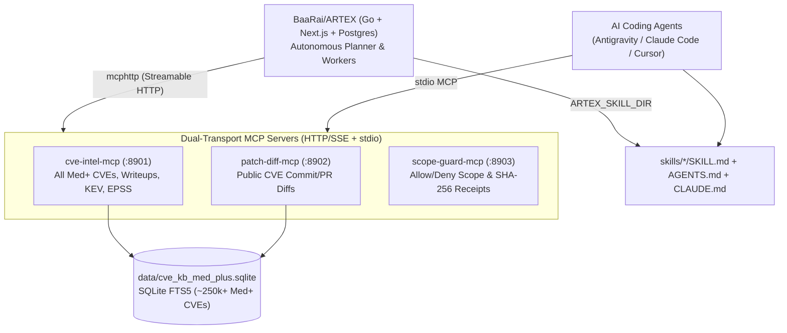

# ARTEX-Nexus

**The open-source AI cybersecurity research platform uniting all public Medium+ CVEs & writeups, [`BaaRai/ARTEX`](https://github.com/BaaRai/ARTEX), dual-transport custom MCP servers, and universal agent instructions.**

> **Authorized Use Only:** Designed strictly for authorized security research, bug bounty programs within declared scope, white-box auditing, and defensive engineering. See [SECURITY.md](SECURITY.md).

---

## Architecture



## What's Inside

1. **All Public Medium+ CVEs (CVSS ≥ 4.0) & Writeups Pipeline (`pipeline/`)**
   - Aggregates official **CVE JSON 5.0** (`CVEProject/cvelistV5`), **CISA KEV**, **FIRST.org EPSS**, and public writeups/PoC/patch references (`trickest/cve`, `projectdiscovery/nuclei-templates`, vendor advisories).
   - Nightly GitHub Actions builds and publishes a compressed **SQLite + FTS5** database (`cve_kb_med_plus.sqlite.zst`) to **GitHub Releases** so cloning the repo stays instant while giving you sub-50ms offline search over all Medium, High, and Critical CVEs.
2. **`BaaRai/ARTEX` Submodule & Unified Stack (`vendor/ARTEX`, `docker-compose.yml`)**
   - Launches PostgreSQL, `BaaRai/ARTEX` (pre-mounted with our `skills/` directory via `ARTEX_SKILL_DIR`), and all 3 MCP servers over Streamable HTTP.
3. **3 Brand-New Dual-Transport Custom MCP Servers (`mcps/`)**
   - **`cve-intel-mcp`** (`search_cves`, `get_cve_details`, `match_product_cves`, `list_cwe_writeups`, `get_kb_stats`)
   - **`patch-diff-mcp`** (`find_patch_links_for_cve`, `fetch_cve_patch_diff`, `extract_diff_hunks`) — allowlisted HTTPS hosts (`github.com`, `api.github.com`, `gitlab.com`)
   - **`scope-guard-mcp`** (`load_scope_policy`, `check_target_in_scope`, `list_in_scope_assets`, `record_evidence_receipt`, `export_report`) — deterministic wildcard/CIDR allow/deny enforcement + tamper-evident SHA-256 receipts + Markdown/SARIF 2.1.0 export
4. **Universal Agent Instructions & Skills (`AGENTS.md`, `CLAUDE.md`, `.cursor/rules/`, `skills/`)**
   - Works out-of-the-box with **BaaRai/ARTEX**, **Antigravity**, **Claude Code**, **Cursor**, and any MCP-compatible client.

---

## Quick Start

### 1. Clone with the ARTEX submodule
```bash
git clone --recurse-submodules https://github.com/blah-blah-cell/artex-nexus.git
cd artex-nexus
```

### 2. Install Python dependencies & bootstrap the Medium+ CVE database
```bash
pip install -e ".[dev,compression]"

# Option A: Download the full nightly Medium+ CVE + Writeups SQLite DB from GitHub Releases
python -m pipeline.bootstrap

# Option B: Build an instant 5-second starter DB from live CISA KEV + EPSS
python -m pipeline.bootstrap --kev-seed
```

### 3. Launch ARTEX + MCP HTTP Stack (Docker Compose)
```bash
cp .env.example .env   # Set POSTGRES_PASSWORD
docker compose up -d --build
```
- ARTEX Web Console: `http://localhost:8787`
- MCP HTTP Endpoints (for ARTEX `mcphttp` config):
  - `http://cve-intel-mcp:8901/mcp`
  - `http://patch-diff-mcp:8902/mcp`
  - `http://scope-guard-mcp:8903/mcp`

### 4. Connect to IDE Agents (stdio MCP)
Copy the server entries from [`config/mcp.client.example.json`](config/mcp.client.example.json) into your Antigravity, Claude Code, or Cursor MCP settings.

---

## Building the Full Medium+ CVE Database Locally
```bash
git clone --depth 1 https://github.com/CVEProject/cvelistV5.git /tmp/cvelistV5
git clone --depth 1 https://github.com/trickest/cve.git /tmp/trickest-cve
git clone --depth 1 https://github.com/projectdiscovery/nuclei-templates.git /tmp/nuclei-templates

python -m pipeline.sync_cves \
  --source-dir /tmp/cvelistV5/cves \
  --trickest-dir /tmp/trickest-cve \
  --nuclei-dir /tmp/nuclei-templates \
  --min-cvss 4.0 \
  --compress
```

---

## License
- ARTEX-Nexus code, MCP servers, pipeline, and skills: **MIT** ([LICENSE](LICENSE))
- `vendor/ARTEX` submodule (`BaaRai/ARTEX`): **AGPL-3.0** ([THIRD_PARTY_NOTICES.md](THIRD_PARTY_NOTICES.md))
