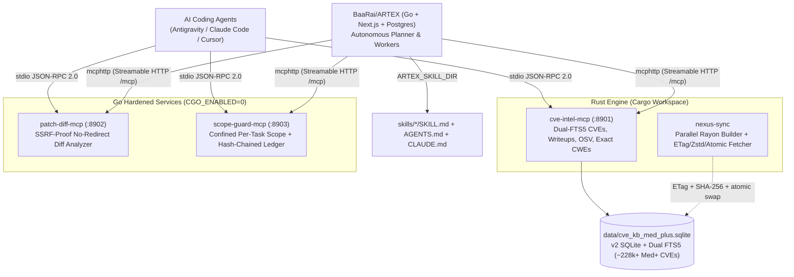

# ARTEX-Nexus

**High-performance Rust + Go cybersecurity research platform uniting all public Medium+ CVEs, OSV/GHSA advisory writeups & package version ranges, [`BaaRai/ARTEX`](https://github.com/BaaRai/ARTEX), dual-transport native MCP servers, and universal agent instructions.**

> **Authorized Use Only:** Designed strictly for authorized security research, bug bounty programs within declared scope, white-box auditing, and defensive engineering. See [SECURITY.md](SECURITY.md).

---

## Architecture (Native Rust + Go)



## Key Engineering Highlights (v0.2 Rust + Go Rewrite)

1. **Rust Parallel Ingestion & Streaming Local DB Fetcher (`crates/nexus-sync`)**
   - Multi-threaded `rayon` ingestion of `CVEProject/cvelistV5`, **CISA KEV**, **FIRST.org EPSS**, **GitHub Advisory Database (GHSA/OSV)** (real advisory writeup excerpts + exact package `introduced`/`fixed` version ranges), `trickest/cve`, and `projectdiscovery/nuclei-templates`.
   - **Zero fabricated data**: unscored KEV entries store `cvss_score = NULL` with `cvss_severity = 'KEV_UNSCORED'` instead of invented scores.
   - **Normalized v2 schema**: dedicated `cve_cwes` join table (exact CWE matching — `CWE-79` never matches `CWE-798`), `cve_packages` table for OSV ranges, `exploit_maturity` ranking (`KEV_EXPLOITED` > `NUCLEI_VERIFIED` > `POC_PUBLIC` > `PATCH_ONLY` > `NONE`), and dual FTS5 indexes (`cves_fts` + `writeups_fts`).
   - **Production-grade `nexus-sync fetch`**: HTTP ETag (`If-None-Match` -> instant `304 Not Modified`), streaming download with on-the-fly SHA-256 verification, streaming Zstd decompression, `PRAGMA quick_check`, and atomic file swap so live MCP servers never see a partial DB.
2. **Rust Native `cve-intel-mcp` (`crates/cve-intel-mcp`)**
   - Single static binary with bundled SQLite + FTS5 + memory-mapped I/O (`PRAGMA mmap_size = 256MB`).
   - Speaks both `stdio` and ARTEX Streamable HTTP (`POST /mcp`, protocol `2025-11-25`).
   - Tools: `search_cves`, `search_writeups`, `get_cve_details`, `match_product_cves`, `list_cwe_writeups`, `whats_new`, `get_kb_stats`.
3. **Go Hardened `patch-diff-mcp` (`go/cmd/patch-diff-mcp`)**
   - Maps `github.com/{owner}/{repo}/commit|pull/...` directly to `api.github.com` (`Accept: application/vnd.github.diff`) with **all redirects disabled** (`http.ErrUseLastResponse`) and a custom DNS-validating `DialContext` that blocks loopback, RFC1918, CGNAT, and cloud metadata IPs (`169.254.169.254`).
4. **Go Hardened `scope-guard-mcp` (`go/cmd/scope-guard-mcp`)**
   - **Path confinement**: `load_scope_policy` resolves symlinks and strictly blocks traversal or files outside `SCOPE_CONFIG_DIR`.
   - **Multi-tenant persisted scopes**: keyed by `scope_id` (so concurrent ARTEX tasks stay isolated) and persisted atomically to disk.
   - **Cryptographically hash-chained ledger**: every receipt links `prev_sha256` -> `sha256` in append-only `receipts.jsonl`, verifiable end-to-end with `verify_ledger_chain`, and exportable to Markdown or SARIF 2.1.0.

---

## Quick Start

### 1. Clone with the `BaaRai/ARTEX` submodule
```bash
git clone --recurse-submodules https://github.com/blah-blah-cell/artex-nexus.git
cd artex-nexus
```

### 2. Build native Rust + Go binaries & fetch the Medium+ CVE DB
```bash
make build

# Stream-download latest nightly Medium+ CVE, OSV & Writeups SQLite DB (ETag + SHA-256 + atomic swap)
./target/release/nexus-sync fetch

# Or build an instant local starter DB from live CISA KEV + EPSS
./target/release/nexus-sync seed-kev
```

### 3. Launch `BaaRai/ARTEX` + Native MCP HTTP Stack
```bash
cp .env.example .env   # Set POSTGRES_PASSWORD
docker compose up -d --build
```
- ARTEX Web Console: `http://localhost:8787`
- Native Streamable HTTP MCP Endpoints (for ARTEX `mcphttp`):
  - `http://cve-intel-mcp:8901/mcp`
  - `http://patch-diff-mcp:8902/mcp`
  - `http://scope-guard-mcp:8903/mcp`

### 4. Connect to IDE Agents (`stdio` MCP)
Copy the server entries from [`config/mcp.client.example.json`](config/mcp.client.example.json) into your Antigravity, Claude Code, or Cursor MCP configuration.

---

## License
- ARTEX-Nexus Rust/Go binaries, MCP servers, and skills: **MIT** ([LICENSE](LICENSE))
- `vendor/ARTEX` submodule (`BaaRai/ARTEX`): **AGPL-3.0** ([THIRD_PARTY_NOTICES.md](THIRD_PARTY_NOTICES.md))
