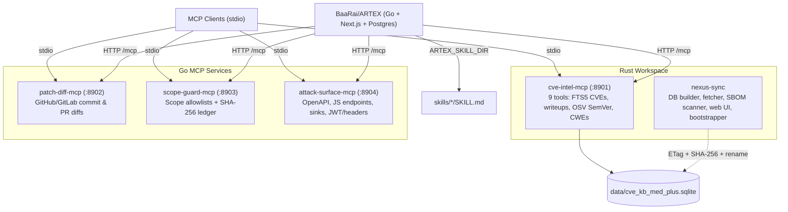

# ARTEX-Nexus

[](https://github.com/blah-blah-cell/artex-nexus/actions/workflows/ci.yml)
[](https://github.com/blah-blah-cell/artex-nexus/releases/tag/cve-db-latest)
[](crates/)
[](go/)
[](TROPHIES.md)
[](LICENSE)

Local CVE/OSV/writeup database, four compiled MCP servers (Rust + Go), offline lockfile scanner, and [`BaaRai/ARTEX`](https://github.com/BaaRai/ARTEX) integration for authorized security testing and vulnerability research.

Only run this against systems you own or have explicit scope to test. See [SECURITY.md](SECURITY.md).

## CVE Database Snapshot (`cve-db-latest`)

GitHub Actions rebuilds the SQLite database nightly from `CVEProject/cvelistV5`, CISA KEV, FIRST EPSS, `github/advisory-database` (OSV/GHSA), `trickest/cve`, and `nuclei-templates`, runs a row-count and `PRAGMA quick_check` sanity gate, and records exact upstream commit SHAs in the release notes. Unscored KEV records keep `cvss_score = NULL` with `cvss_severity = KEV_UNSCORED` rather than inventing a score.

Run `nexus-sync doctor` (or the `get_kb_stats` MCP tool) against your downloaded database to inspect live counts for Medium+ CVEs, CISA KEV entries, writeup excerpts (`writeups_fts`), and OSV/GHSA package version ranges.

## Layout



## What's Included

### `nexus-sync` (`crates/nexus-sync`)
- `fetch`: pulls `cve_kb_med_plus.sqlite.zst` from GitHub Releases with ETag caching (`304`), verifies `SHA256SUMS.txt` (fails if missing unless `--allow-unverified`), runs `PRAGMA quick_check`, and swaps the file in place.
- `build`: builds the SQLite database locally across multiple threads using `rayon`.
- `scan`: checks lockfiles and manifests offline across 10 formats (`package-lock.json`, `package.json` pinned versions, `yarn.lock`, `pnpm-lock.yaml`, `requirements.txt`, `poetry.lock`, `go.mod`, `Cargo.lock`, `composer.lock`, `pom.xml`), exports SARIF 2.1.0, and supports `--fail-on <medium|high|critical>`.
- `serve`: local web console (`127.0.0.1:8088` by default, strict CORS allowlist via `--cors-origin`) for CVE/writeup search, SemVer checks, SHA-256 receipt verification, and local playbooks.
- `bootstrap`: configures a running ARTEX instance with the 4 HTTP MCP servers, all 8 skills, role prompts, `traffic_capture` + `agent_traffic_binding`, turn caps, and optional proxy header rewrite rules.
- `init-mcp` / `doctor`: prints MCP client config JSON and checks DB health.

### MCP Servers (stdio + HTTP `/mcp`)
- `cve-intel-mcp` (`:8901`, Rust): 9 tools (`search_cves`, `search_writeups`, `get_cve_details`, `match_product_cves`, `check_package_version`, `scan_dependencies`, `list_cwe_writeups`, `whats_new`, `get_kb_stats`). Pooled read-only SQLite connections reload automatically when the DB file changes.
- `patch-diff-mcp` (`:8902`, Go): fetches unified diffs from `github.com`, `api.github.com`, and `gitlab.com` with redirects disabled and private/reserved IPs blocked at dial time. `GITHUB_TOKEN` is only sent to `api.github.com`.
- `scope-guard-mcp` (`:8903`, Go): loads YAML/JSON scope policies confined inside `SCOPE_CONFIG_DIR`, supports `--default-policy` at startup, keeps scopes isolated per `scope_id`, and writes a SHA-256 hash-chained `receipts.jsonl` exportable to Markdown or SARIF 2.1.0.
- `attack-surface-mcp` (`:8904`, Go): offline OpenAPI auditor (resolves `#/components/schemas` `$ref`s), JS bundle endpoint/version extractor, static source sink scanner (all file reads confined inside `-workspace-dir` / `ATTACK_SURFACE_ROOT`), and JWT + HTTP header/cookie checker.

### UI Overlay & Skills
- `ui-overlay/` + `scripts/build-artex-ui.{sh,ps1}`: embeds a `/nexus` page into `BaaRai/ARTEX` (`-tags embedui`) without modifying `vendor/ARTEX`. Includes agent routing status, MCP tool refresh, CVE/SemVer lookups, receipt verification, and provider-agnostic OpenAI-compatible model routing.
- `skills/*/SKILL.md`: 8 skill playbooks, including `spa-js-endpoint-hunting` and `smart-api-fuzzing` (wires up upstream [`schemathesis/schemathesis`](https://github.com/schemathesis/schemathesis) and [`Endava/cats`](https://github.com/Endava/cats) through ARTEX's capture proxy).

## Quick Start

Clone with the upstream `BaaRai/ARTEX` submodule:
```bash
git clone --recurse-submodules https://github.com/blah-blah-cell/artex-nexus.git
cd artex-nexus
```

Build binaries and pull the latest CVE database:
```bash
make build
./target/release/nexus-sync fetch
./target/release/nexus-sync doctor

# Local web console (http://127.0.0.1:8088)
./target/release/nexus-sync serve

# Offline lockfile scan + SARIF output
./target/release/nexus-sync scan --path . --sarif sbom.sarif --fail-on high
```

Run the Docker Compose stack (Postgres, ARTEX, all 4 MCP servers, and the local console):
```bash
cp .env.example .env   # set POSTGRES_PASSWORD
docker compose up -d --build
```

Generate stdio config for your editor or CLI agent:
```bash
./target/release/nexus-sync init-mcp --client claude   # antigravity | cursor | zcode | freebuff | artex
```

## Found a Bug With This?

If ARTEX-Nexus helped find a disclosed vulnerability or CVE, feel free to add it to [TROPHIES.md](TROPHIES.md) via the [issue template](https://github.com/blah-blah-cell/artex-nexus/issues/new?template=cve-trophy.yml). Do not post undisclosed vulnerabilities or private program details in public issues.

## License

- ARTEX-Nexus code, MCP servers, templates, and skills: MIT ([LICENSE](LICENSE))
- `vendor/ARTEX` (`BaaRai/ARTEX`): AGPL-3.0 ([THIRD_PARTY_NOTICES.md](THIRD_PARTY_NOTICES.md))
- Upstream CVE/OSV/KEV/EPSS feeds keep their original licenses ([THIRD_PARTY_NOTICES.md](THIRD_PARTY_NOTICES.md))
