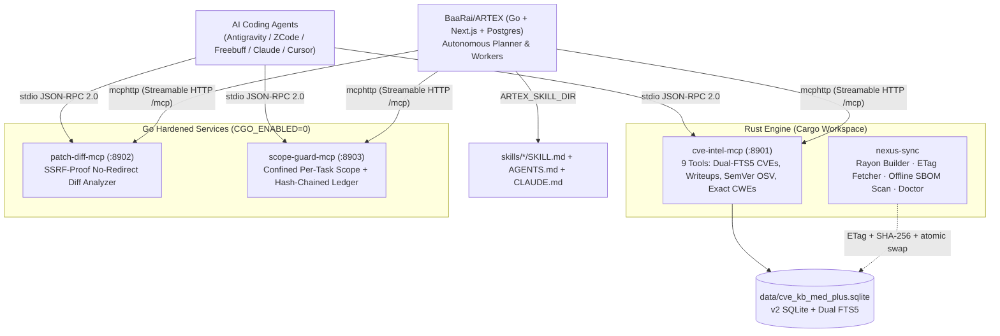

# ARTEX-Nexus

[](https://github.com/blah-blah-cell/artex-nexus/actions/workflows/ci.yml)
[](https://github.com/blah-blah-cell/artex-nexus/releases/tag/cve-db-latest)
[](crates/)
[](go/)
[](TROPHIES.md)
[](LICENSE)

**High-performance Rust + Go cybersecurity research platform uniting all public Medium+ CVEs, OSV/GHSA advisory writeups & package version ranges, offline SBOM lockfile scanning, [`BaaRai/ARTEX`](https://github.com/BaaRai/ARTEX), dual-transport native MCP servers, and universal agent instructions.**

> **Authorized Use Only:** Built strictly for authorized security research, bug bounty programs within declared scope, white-box auditing, and defensive engineering. See [SECURITY.md](SECURITY.md).

---

## Discovered a Vulnerability or Got a CVE Using ARTEX-Nexus?

If ARTEX-Nexus helped you discover a real vulnerability or earn a CVE assignment in an authorized target or open-source project, **please report it to our [CVE Trophy Case](TROPHIES.md)**!
- Submit once publicly disclosed/patched via the [**CVE / Vulnerability Discovery Issue Form**](https://github.com/blah-blah-cell/artex-nexus/issues/new?template=cve-trophy.yml) or open a PR to [TROPHIES.md](TROPHIES.md).
- Need a CNA-ready disclosure writeup? Use [`knowledge/templates/cve-disclosure-template.md`](knowledge/templates/cve-disclosure-template.md).
- **Important:** Never post undisclosed zero-days or confidential bug bounty details in public issues.

---

## Live Knowledge Base Scale (Nightly Rust v2 Build)

| Metric | Live Coverage (`cve-db-latest`) |
|---|---|
| **Medium+ CVEs (CVSS ≥ 4.0 + Unscored KEV)** | `227,942+` |
| **CISA KEV Entries** | `1,792+` |
| **Writeup, Advisory, Nuclei & Patch Links** | `1,055,517+` |
| **Full Indexed GHSA/OSV Technical Writeups** | `21,871+` (`writeups_fts`) |
| **Exact OSV/GHSA Package Version Ranges** | `43,536+` (`npm`, `PyPI`, `Go`, `Maven`, `crates.io`, etc.) |
| **Measured Local Search Latency (`cve-intel-mcp`)** | `~1.2 ms` (FTS5 + 256 MiB mmap SQLite) |

---

## Architecture (Native Rust + Go)



---

## Features & Components

1. **Rust Ingestion, Streaming Fetcher & Offline SBOM Scanner (`crates/nexus-sync`)**
   - `nexus-sync fetch`: HTTP ETag caching (`304 Not Modified`), streaming download with on-the-fly SHA-256 verification, streaming Zstd decompression, `PRAGMA quick_check`, and atomic swap.
   - `nexus-sync scan --path <dir-or-lockfile>`: Offline SemVer/OSV vulnerability scanner supporting `package-lock.json`, `package.json`, `requirements.txt`, `go.mod`, and `Cargo.lock`.
   - `nexus-sync doctor`: Instant DB integrity, schema version, and coverage diagnostics.
   - `nexus-sync build`: Multi-threaded `rayon` ingestion of `CVEProject/cvelistV5`, CISA KEV, FIRST EPSS, `github/advisory-database` (OSV/GHSA), `trickest/cve`, and `nuclei-templates` — zero fabricated CVSS scores (`NULL` + `KEV_UNSCORED`).
2. **Rust Native `cve-intel-mcp` (`crates/cve-intel-mcp`, 9 MCP Tools)**
   - Dual transport: `stdio` + ARTEX Streamable HTTP (`POST /mcp`, protocol `2025-11-25`).
   - Tools: `search_cves`, `search_writeups`, `get_cve_details`, `match_product_cves`, `check_package_version`, `scan_dependencies`, `list_cwe_writeups`, `whats_new`, `get_kb_stats`.
3. **Go Hardened `patch-diff-mcp` (`go/cmd/patch-diff-mcp`)**
   - Direct `api.github.com` diff endpoint (`Accept: application/vnd.github.diff`), **all HTTP redirects refused**, and DNS-resolving `DialContext` blocking loopback, RFC1918, CGNAT, and cloud metadata IPs (`169.254.169.254`).
4. **Go Hardened `scope-guard-mcp` (`go/cmd/scope-guard-mcp`)**
   - Symlink-safe `SCOPE_CONFIG_DIR` confinement, multi-tenant persisted `scope_id` isolation, and a cryptographically hash-chained append-only ledger (`receipts.jsonl`) verified by `verify_ledger_chain` and exportable to Markdown or SARIF 2.1.0.
5. **Universal Skills, Playbooks & `BaaRai/ARTEX` Stack**
   - Modular skills (`skills/*/SKILL.md`), CWE & Web/API playbooks (`knowledge/playbooks/`), CNA disclosure template (`knowledge/templates/`), and unified `docker-compose.yml` mounting `vendor/ARTEX`.

---

## Quick Start

### 1. Clone with the `BaaRai/ARTEX` submodule
```bash
git clone --recurse-submodules https://github.com/blah-blah-cell/artex-nexus.git
cd artex-nexus
```

### 2. Build native binaries, fetch the CVE/OSV DB & verify health
```bash
make build
./target/release/nexus-sync fetch
./target/release/nexus-sync doctor

# Offline dependency scan on any repo or lockfile
./target/release/nexus-sync scan --path .
```

### 3. Launch `BaaRai/ARTEX` + Native MCP HTTP Stack
```bash
cp .env.example .env   # Set POSTGRES_PASSWORD
docker compose up -d --build
```
- ARTEX Web Console: `http://localhost:8787`
- Native Streamable HTTP MCP Endpoints (`mcphttp`):
  - `http://cve-intel-mcp:8901/mcp`
  - `http://patch-diff-mcp:8902/mcp`
  - `http://scope-guard-mcp:8903/mcp`

### 4. Connect to IDE Agents (`stdio` MCP)
Copy the server entries from [`config/mcp.client.example.json`](config/mcp.client.example.json) into Antigravity, ZCode, Freebuff, Claude Code, or Cursor.

---

## Governance, Security & Licensing

- **Security & Coordinated Disclosure:** [SECURITY.md](SECURITY.md)
- **CVE Trophy Hall of Fame:** [TROPHIES.md](TROPHIES.md)
- **Contributing & Code of Conduct:** [CONTRIBUTING.md](CONTRIBUTING.md) · [CODE_OF_CONDUCT.md](CODE_OF_CONDUCT.md)
- **Licensing:**
  - ARTEX-Nexus Rust/Go code, MCP servers, templates, and skills: **MIT** ([LICENSE](LICENSE))
  - `vendor/ARTEX` submodule (`BaaRai/ARTEX`): **AGPL-3.0** ([THIRD_PARTY_NOTICES.md](THIRD_PARTY_NOTICES.md))
  - Upstream public vulnerability feeds & advisories retain their respective upstream licenses ([THIRD_PARTY_NOTICES.md](THIRD_PARTY_NOTICES.md))
